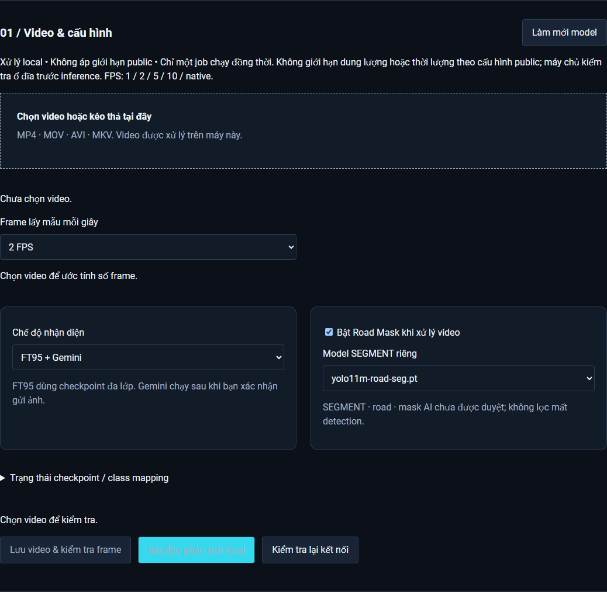

# RoadGuard AI

RoadGuard hỗ trợ rà soát khuyết tật trên **mặt đường bê tông xi măng** từ video UAV. Detection Studio lấy mẫu khung hình, chạy nhận diện và mở Review Queue để người dùng kiểm tra bằng chứng trước khi duyệt.

## Luồng xử lý

Video → job cục bộ → khung hình → FT95 hoặc cặp model legacy → Road Mask tùy chọn → Review Queue → báo cáo theo phiên bản.

- **Detection Studio và API** dùng FastAPI và lưu job, sự kiện, khung hình và kết quả dưới `results/mvp_video28/`.
- **FT95** là cấu hình mặc định: `alligator crack`, `longitudinal crack`, `oblique crack`, `pothole`, `repair`, `transverse crack`. Crack V1 và model ổ gà legacy có thể được chọn theo cặp.
- **Road Mask** hiển thị vùng đường dự đoán. Detection giao biên, nằm ngoài mask hoặc ở khung hình thiếu mask được giữ lại và đánh dấu để rà soát.
- **Review Queue** lưu quyết định theo revision, phân biệt proposal AI, box được duyệt và phạm vi đã xác minh. Báo cáo chuyển từ draft đến ready rồi approved với xác nhận của người dùng.
- **CKEY Vision** là bước tùy chọn trên frame của job đã hoàn tất. Chế độ Vision xem ảnh độc lập, còn FT95 + Vision cung cấp thêm đề xuất FT95. Chạy API cần xác nhận chi phí. Kết quả vẫn là proposal.
- **CKEY Report AI** có model riêng và tạo bản nháp khi contract được xác minh. Model báo cáo mặc định chưa được kiểm chứng trực tiếp.

## Giao diện

Các ảnh dưới đây chụp từ trình duyệt thật khi chạy kiểm thử tích hợp với **dữ liệu tổng hợp**. Các box và số liệu trong ảnh dùng để minh họa giao diện.

| Chọn model và video | Kết quả theo khung hình |
| --- | --- |
|  |  |
| **Review Queue** | **Báo cáo đã duyệt trong ca kiểm thử** |
|  |  |


[Ảnh tham chiếu mặt đường bê tông xi măng có khe cắt](https://commons.wikimedia.org/wiki/File:Completed_Whitetopping_ND_(8473502899).jpg), Federal Highway Administration, CC BY 2.0.

## Cài đặt và chạy

Dùng Python 3.12 và cài dependency trong môi trường ảo:

```bash
python -m venv .venv
# Kích hoạt môi trường ảo theo hệ điều hành, sau đó chạy:
python -m pip install -r requirements.txt
python -m uvicorn src.api.ui_server:app --host 127.0.0.1 --port 8080
```

Mở [Detection Studio](http://127.0.0.1:8080/). Đặt checkpoint tin cậy vào:

- `weights/trained/RoadGuard_YOLO11_UAVPDD2023_FT95_v1.pt` cho mặc định FT95.
- `weights/trained/roadguard_crack_yolo11n_v1.pt` và `weights/trained/best (1).pt` khi cần rollback.
- `weights/pretrained/yolo11m-road-seg.pt` khi dùng Road Mask.

`configs/mvp_video.json` lưu cấu hình của Studio. Có thể đặt `RG_VIDEO_MODEL_DIR` để đổi thư mục detector. Với CKEY, dùng `.env.example` làm mẫu cho `.env` và giữ key phía server. Chỉ bật xác minh Report sau khi kiểm thử contract của provider. Xem [hướng dẫn backend](docs/backend-integration.md) để tải video, lấy kết quả, review và xuất báo cáo.

Công cụ pilot chạy cục bộ bằng `python -m tools.annotate_dji_crack_pilot --pilot <pilot-dir>` và `python -m tools.roadmask_pilot --help`. Chuẩn bị bộ pilot bằng `python -m tools.prepare_dji_crack_pilot --help`. Liên kết crack ngoài luồng Studio có entrypoint thử nghiệm `python -m src.inference.crack_video --help`.

## Kiểm thử và phạm vi triển khai

Cài Node.js, rồi chạy `npm install --no-save --no-package-lock playwright`. Trên Windows, test có thể dùng Edge hoặc Chrome đã cài. Trên môi trường khác, dùng `npx playwright install chromium` hoặc đặt `ROADGUARD_BROWSER` tới trình duyệt tương thích. Cung cấp các checkpoint ở trên trước khi chạy `python -m unittest discover -s tests -t . -v`.

Kiểm tra dịch vụ từ máy chủ bằng `GET /api/mvp-video/config`, sau đó kiểm tra trạng thái model trong `GET /api/mvp-video/models`. Chạy một process tại loopback, lưu bền thư mục kết quả và giới hạn dung lượng, thời gian vận hành theo dữ liệu thực. Khi triển khai qua backend, cần xác thực, phân quyền job và cô lập dữ liệu ở lớp dịch vụ trước khi mở truy cập mạng.

FT95 chưa có benchmark độc lập xác nhận hiệu năng riêng trên bê tông xi măng. Số box là số lần quan sát. Road Mask chưa duyệt, Vision và kết quả AI âm tính không phải Ground Truth. Vision CKEY đã qua kiểm tra schema với 1 ảnh PNG và một batch 5 ảnh DJI thu nhỏ 768×432. Batch 10 ảnh timeout sau 50 giây. Cấu hình mặc định gửi một ảnh mỗi request. Chưa xác nhận đơn giá hoặc hiệu năng Report AI.

Lịch sử Git được giữ nguyên và có thể còn tham chiếu đường dẫn nội bộ từ các phiên bản cũ. Cây phát hành hiện tại đã được quét để loại các đường dẫn và thông tin xác thực khỏi các tệp phân phối.
