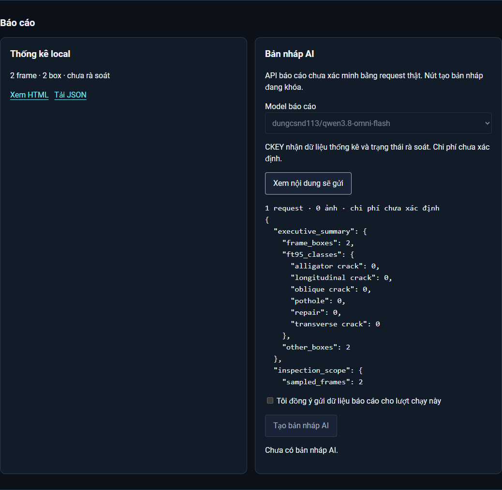
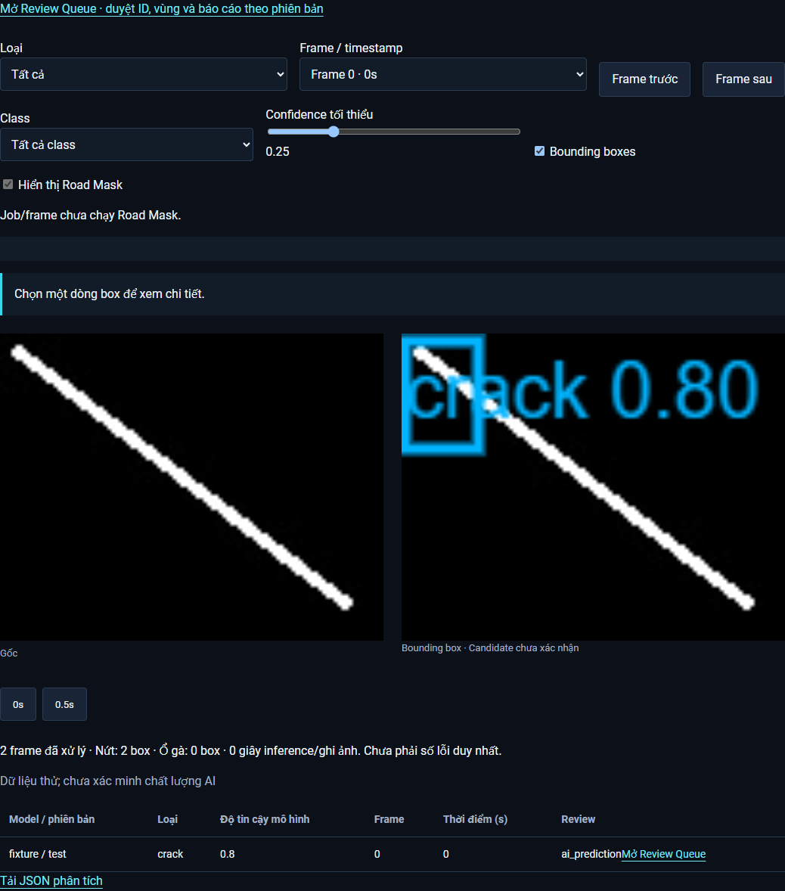
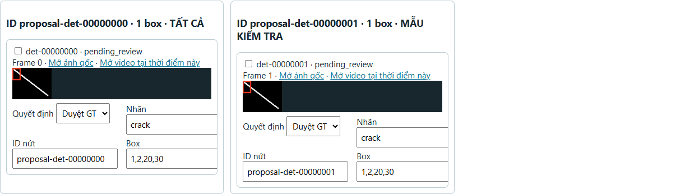
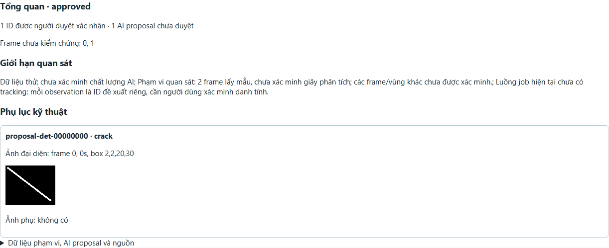

# RoadGuard AI

RoadGuard hỗ trợ rà soát khuyết tật trên **mặt đường bê tông xi măng** từ video UAV. Detection Studio lấy mẫu khung hình, chạy nhận diện và mở Review Queue để người dùng kiểm tra bằng chứng trước khi duyệt.

## Luồng xử lý

Video → job cục bộ → lấy mẫu khung hình → FT95 nếu được chọn → Road Mask tùy chọn → Gemini nếu xác nhận → Review Queue → báo cáo.

- **Detection Studio và API** dùng FastAPI và lưu job, sự kiện, khung hình và kết quả dưới `results/mvp_video28/`.
- **FT95** là detector mặc định của chế độ kết hợp: `alligator crack`, `longitudinal crack`, `oblique crack`, `pothole`, `repair`, `transverse crack`. API legacy vẫn hỗ trợ cặp Crack V1 và model ổ gà.
- **Road Mask** hiển thị vùng đường dự đoán. Detection giao biên, nằm ngoài mask hoặc ở khung hình thiếu mask được giữ lại và đánh dấu để rà soát.
- **Review Queue** lưu quyết định theo revision, phân biệt proposal AI, box được duyệt và phạm vi đã xác minh. Báo cáo chuyển từ draft đến ready rồi approved với xác nhận của người dùng.
- **CKEY Vision** là bước tùy chọn trên frame của job đã hoàn tất. Chế độ Vision xem ảnh độc lập, còn FT95 + Vision cung cấp thêm đề xuất FT95. Chạy API cần xác nhận chi phí. Kết quả vẫn là proposal.
- **CKEY Report AI** có model riêng và tạo bản nháp khi contract được xác minh. Model báo cáo mặc định chưa được kiểm chứng trực tiếp.

## Giao diện



Các ảnh dưới đây chụp từ trình duyệt thật khi chạy kiểm thử tích hợp với **dữ liệu tổng hợp**. Các box và số liệu trong ảnh dùng để minh họa giao diện.

| Chọn model và video | Kết quả theo khung hình |
| --- | --- |
|  |  |
| **Review Queue** | **Báo cáo đã duyệt trong ca kiểm thử** |
|  |  |


[Ảnh tham chiếu mặt đường bê tông xi măng có khe cắt](https://commons.wikimedia.org/wiki/File:Completed_Whitetopping_ND_(8473502899).jpg), Federal Highway Administration, CC BY 2.0.

## Cài đặt và chạy

Dùng Python 3.12 và cài dependency trong môi trường ảo:

```bash
python -m venv .venv
# Kích hoạt môi trường ảo theo hệ điều hành, sau đó chạy:
python -m pip install -r requirements.txt
python -m uvicorn src.api.ui_server:app --host 127.0.0.1 --port 8081
```

Mở Detection Studio tại địa chỉ Uvicorn in ra, ví dụ [127.0.0.1:8081](http://127.0.0.1:8081/). Cổng 8081 là cổng kiểm thử hiện tại. Bạn có thể chọn cổng trống khác. Đặt checkpoint tin cậy vào:

- `weights/trained/RoadGuard_YOLO11_UAVPDD2023_FT95_v1.pt` cho mặc định FT95.
- `weights/trained/roadguard_crack_yolo11n_v1.pt` và `weights/trained/best (1).pt` khi cần rollback.
- `weights/pretrained/yolo11m-road-seg.pt` khi dùng Road Mask.

`configs/mvp_video.json` lưu cấu hình của Studio. Có thể đặt `RG_VIDEO_MODEL_DIR` để đổi thư mục detector. Với CKEY, dùng `.env.example` làm mẫu cho `.env` và giữ key phía server. Chỉ bật xác minh Report sau khi kiểm thử contract của provider. Xem [hướng dẫn backend](docs/backend-integration.md) để tải video, lấy kết quả, review và xuất báo cáo.

Công cụ pilot chạy cục bộ bằng `python -m tools.annotate_dji_crack_pilot --pilot <pilot-dir>` và `python -m tools.roadmask_pilot --help`. Chuẩn bị bộ pilot bằng `python -m tools.prepare_dji_crack_pilot --help`. Liên kết crack ngoài luồng Studio có entrypoint thử nghiệm `python -m src.inference.crack_video --help`.

## Sử dụng Detection Studio

Tất cả thao tác dưới đây xử lý trên máy và không phí API, trừ hai nút gửi Gemini và tạo bản nháp AI. Video, job, ảnh, log, revision và báo cáo được lưu trong `results/mvp_video28/<job_id>/`.

| Khu vực và nút | Khi dùng và kết quả |
| --- | --- |
| Dashboard và thanh điều hướng | Dashboard đếm job đã lưu, hoàn tất và lỗi. Các liên kết chuyển tới từng khu vực trong trang. |
| Chọn hoặc kéo thả video | Chọn MP4, MOV, AVI hoặc MKV. Trình phát gốc hỗ trợ phát, dừng, tua và xem trước nội dung file đã chọn. |
| FPS | Chọn 1/2/5/10 hoặc Native để lấy toàn bộ frame. Số frame xấp xỉ thời lượng nhân FPS lấy mẫu, có giới hạn theo FPS nguồn. Khi chuẩn bị xong, Studio hiển thị số frame máy chủ xác nhận từ metadata. |
| Chế độ nhận diện | FT95 Local chỉ chạy detector local. Gemini Vision trích frame và có thể tạo mask, không chạy FT95. FT95 + Gemini lưu detection local trước rồi chờ bạn xác nhận gửi ảnh. |
| Bật Road Mask và chọn SEGMENT | Bật mặc định. Chọn checkpoint có sẵn. Nếu không có checkpoint, làm mới model hoặc tắt mask để chạy. Box ngoài mask vẫn được hiển thị để rà soát. |
| Làm mới model và Trạng thái checkpoint | Làm mới quét lại model. Mở mục trạng thái để xem task, lớp, phiên bản và lý do thiếu model. |
| Lưu video & kiểm tra frame | Bật khi có video, model cần thiết và kết nối local. Tải lên máy chủ RoadGuard local, tạo job READY và kiểm tra số frame, chưa chạy detector hay gọi provider. |
| Bắt đầu phân tích local | Bật sau bước chuẩn bị. Đưa job vào hàng đợi, ghi frame, box và mask theo cấu hình. |
| Kiểm tra lại kết nối | Tải lại cấu hình máy chủ, đối soát job đang mở nếu có. |
| Hủy xử lý | Dùng khi đang upload, job READY hoặc đang xử lý. Hủy upload hoặc ghi nhận yêu cầu dừng. Kết quả đã lưu được giữ lại. |
| Frame / timestamp, Frame trước/sau và mốc | Có khi job hoàn tất. Chuyển khung hình để xem ảnh gốc và bằng chứng. |
| Loại, Class, Confidence tối thiểu, dòng box | Lọc bảng/overlay FT95 trên màn hình. Bấm dòng box xem chi tiết; bộ lọc không sửa kết quả lưu. |
| Bounding boxes và Hiển thị Road Mask | Bật/tắt lớp vẽ theo frame đang xem. Toggle mask chỉ khả dụng khi frame có overlay. Nét liền là FT95, nét đứt là Gemini. |
| Mở Review Queue và Tải JSON phân tích | Mở trang review hoặc tải dữ liệu AI của job đã hoàn tất. JSON phân tích giữ nguyên kết quả ban đầu. |
| Xem dự toán request | Bật sau khi job có chế độ Gemini hoàn tất bước local. Hiển thị số ảnh và số request dự kiến, chưa gửi dữ liệu. |
| Đồng ý gửi ảnh và Gửi ảnh cho Gemini | Bật sau dự toán, khi Vision khả dụng. Lượt chạy gửi frame PNG thu nhỏ và box FT95 nếu ở chế độ Hybrid đến CKEY. Có thể tính phí. Lưu proposal, provenance và trạng thái lượt chạy dưới `ckey_runs/<run_id>/`. |
| Xem HTML và Tải JSON | Có sau khi job hoàn tất. Làm mới thống kê từ dữ liệu lưu và revision review hiện hành, rồi mở hoặc tải `report_local.html` / `report_local.json`. |
| Model báo cáo | Hiển thị model `dungcsnd113/qwen3.8-omni-flash` hoặc model do máy chủ cấu hình. Model API mặc định đang chờ kiểm chứng. |
| Xem nội dung sẽ gửi | Hiển thị dữ liệu tổng hợp, **1 request, 0 ảnh**, chi phí chưa xác định. Chỉ đọc snapshot local. |
| Đồng ý gửi dữ liệu báo cáo và Tạo bản nháp AI | Bật khi có nội dung xem trước, credential và contract đã xác minh. Mỗi lượt cần xác nhận riêng. Chỉ gửi thống kê và trạng thái rà soát, không gửi file ảnh hoặc video. Bản nháp lưu riêng dưới `ckey_runs/<run_id>/`. |
| Tải bản nháp JSON | Hiện khi đã có bản nháp hợp lệ. Nếu lượt chạy lại lỗi, bản nháp thành công gần nhất vẫn tải được. |
| Làm mới lịch sử và Mở phiên | Đọc danh sách job đã lưu hoặc mở lại job đã chọn. Job gián đoạn không tự chạy lại. |
| Nhật ký xử lý, Đóng, Mức log, Tự cuộn | Mở/đóng panel, lọc và cuộn log tại máy. Mở Chi tiết kỹ thuật để xem mã, frame và thông tin sự kiện. |
| Sao chép ID phiên / chi tiết lỗi, Xóa hiển thị | Sao chép vào clipboard hoặc dọn phần đang hiển thị. Nhật ký đã ghi vẫn được giữ lại. |

### Thử từng luồng

1. **FT95 Local:** Tải video → chọn FT95 Local và FPS → Lưu video & kiểm tra frame → Bắt đầu phân tích local → xem frame và box.
2. **Gemini Vision:** Chọn Gemini Vision, chuẩn bị và chạy bước local. Xem dự toán rồi xác nhận gửi ảnh. Proposal xuất hiện khi CKEY trả kết quả hợp lệ.
3. **Hybrid + Road Mask:** Chọn FT95 + Gemini, giữ mask bật và chạy local. Xem ảnh gốc, mask và box trước khi quyết định gửi ảnh. Kết quả local vẫn mở được nếu Gemini lỗi hoặc timeout.
4. **Review Queue:** Mở từ kết quả, lọc mục và chọn frame. Dùng nút trước/sau, phóng ảnh, mở ảnh hoặc video gốc và bật mask khi có. So sánh FT95/Gemini. Chỉnh nhãn, box hoặc ID, chọn mục, nhập người duyệt và xác nhận để lưu revision. Box Gemini có tọa độ có thể điền vào form chỉnh tay. Vùng đã xem, bỏ qua và vùng chưa xác minh lưu riêng. Khôi phục tạo revision mới và cần lý do. Proposal AI hoặc một box được duyệt không tự xác minh toàn frame.
5. **Local Report:** Mở Xem HTML hoặc Tải JSON. Báo cáo tách box theo frame, nhãn do người dùng duyệt và số ID vật lý theo báo cáo đã phê duyệt cùng revision, nếu có.
6. **AI Report:** Mở nội dung sẽ gửi và kiểm tra trạng thái. Khi API được xác minh, đồng ý rồi bấm Tạo bản nháp AI. Duyệt chính thức vẫn thực hiện trong Review Queue bằng Tạo draft mới → ready_for_approval → chấp nhận giới hạn và xác nhận cuối. Bản nháp AI không tự duyệt.
7. **Mở lại job cũ:** Làm mới lịch sử và Mở phiên. Link job đã mất không hiển thị lỗi cũ trên trang rỗng.

| Vấn đề | Cách kiểm tra |
| --- | --- |
| Nút chuẩn bị bị khóa | Kiểm tra định dạng video, cấu hình model, kết nối và dung lượng. Nếu thiếu Road Mask, chọn checkpoint hợp lệ hoặc tắt mask. |
| API Gemini timeout hoặc lỗi schema | Xem trạng thái lượt chạy và log, giữ batch nhỏ. Đồng ý lại nếu thử lượt mới. |
| API Report chưa xác minh | Vẫn xem được báo cáo local và nội dung xem trước. Cần thử API thật có phê duyệt riêng, một request văn bản. |
| Báo cáo AI yêu cầu xem trước lại | Bản review hoặc model đã đổi. Xem snapshot mới và xác nhận lại. |

## Kiểm thử và phạm vi triển khai

Cài Node.js, rồi chạy `npm install --no-save --no-package-lock playwright`. Trên Windows, test có thể dùng Edge hoặc Chrome đã cài. Trên môi trường khác, dùng `npx playwright install chromium` hoặc đặt `ROADGUARD_BROWSER` tới trình duyệt tương thích. Cung cấp các checkpoint ở trên trước khi chạy `python -m unittest discover -s tests -t . -v`.

Kiểm tra dịch vụ từ máy chủ bằng `GET /api/mvp-video/config`, sau đó kiểm tra trạng thái model trong `GET /api/mvp-video/models`. Chạy một process tại loopback, lưu bền thư mục kết quả và giới hạn dung lượng, thời gian vận hành theo dữ liệu thực. Khi triển khai qua backend, cần xác thực, phân quyền job và cô lập dữ liệu ở lớp dịch vụ trước khi mở truy cập mạng.

FT95 chưa có benchmark độc lập xác nhận hiệu năng riêng trên bê tông xi măng. Số box là số lần quan sát. Road Mask chưa duyệt, Vision và kết quả AI âm tính không phải Ground Truth. Vision CKEY đã qua kiểm tra schema với 1 ảnh PNG và một batch 5 ảnh DJI thu nhỏ 768×432. Batch 10 ảnh timeout sau 50 giây. Cấu hình mặc định gửi một ảnh mỗi request. Chưa xác nhận đơn giá hoặc hiệu năng Report AI.

Lịch sử Git được giữ nguyên và có thể còn tham chiếu đường dẫn nội bộ từ các phiên bản cũ. Cây phát hành hiện tại đã được quét để loại các đường dẫn và thông tin xác thực khỏi các tệp phân phối.
