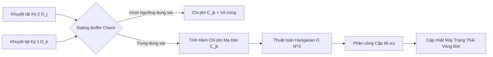
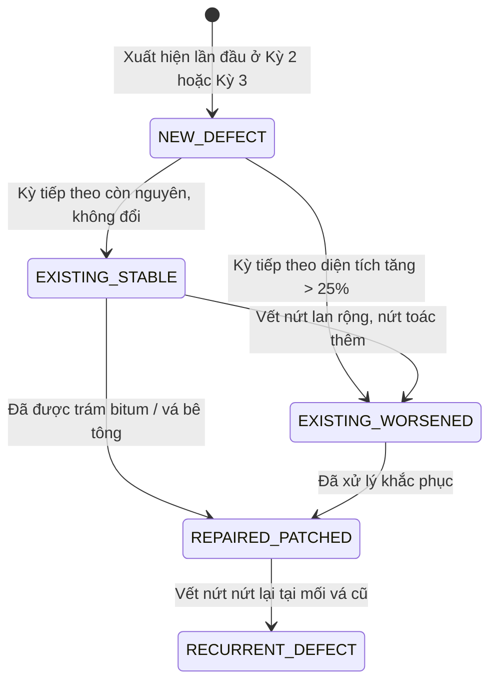

# KIẾN TRÚC TOÁN HỌC & GIẢI THUẬT ĐỐI CHIẾU KHUYẾT TẬT ĐA KỲ KHẢO SÁT (LẦN 1, LẦN 2, LẦN 3)
## Hệ thống RoadGuard AI: Quản lý Vòng đời Khuyết tật Mặt đường Bê tông Xi măng

---

### TÓM TẮT BÀI TOÁN KỸ THUẬT
Trong các dự án bảo trì hạ tầng giao thông thực tế:
- **Phía Backend (BE) cung cấp**:
  1. Tọa độ tuyến tim đường (Polyline GPS: tập hợp các điểm trắc địa mốc $[(Lat_0, Lon_0), (Lat_1, Lon_1), \dots]$).
  2. Chiều dài tuyến đường $L$ (mét) và Chiều rộng mặt đường bê tông $W$ (mét).
  3. Video khảo sát bay kèm file phụ đề viễn thám `SRT` của từng đợt bay:
     - **Kỳ 1 ($S_1$)**: Khảo sát hiện trạng ban đầu (Baseline Survey).
     - **Kỳ 2 ($S_2$)**: Khảo sát định kỳ sau 3 - 6 tháng (Follow-up Survey 1).
     - **Kỳ 3 ($S_3$)**: Khảo sát nghiệm thu sau duy tu hoặc kiểm tra chu kỳ năm tiếp theo (Follow-up Survey 2).

- **Thách thức cốt lõi**:
  - Flycam thương mại (như DJI Mini 2 SE) sử dụng bộ thu GNSS/GPS dân sự không có trạm mặt đất RTK. Do đó, tọa độ GPS tuyệt đối giữa các ngày bay khác nhau bị trôi dạt ngẫu nhiên (**GPS Drift**) từ **$1.5\text{m} - 3.0\text{m}$**.
  - Nếu đối chiếu ngây thơ bằng khoảng cách GPS $(\Delta Lat, \Delta Lon) < \epsilon$:
    * Nếu đặt ngưỡng nhỏ ($\epsilon < 1.0\text{m}$): Hệ thống không thể nhận ra vết nứt cũ do GPS bị trôi $2\text{m}$, dẫn tới ghi nhận sai thành một **"Vết nứt mới"** (False New Defect), làm số lượng khuyết tật tăng đột biến giả tạo, vi phạm lịch sử dữ liệu!
    * Nếu đặt ngưỡng lớn ($\epsilon > 3.0\text{m}$): Nếu trên một tấm đan bê tông (dài 4m - 5m) có 2 vết nứt nằm gần nhau, hệ thống sẽ gộp nhầm 2 vết nứt khác nhau làm một (**False Duplicate Merge**).

Tài liệu này công bố giải pháp giải quyết triệt để vấn đề trên dựa trên **Hệ định vị tuyến tính LRS (Linear Referencing System)** kết hợp **Mốc neo hình học tấm đan bê tông bất biến (Concrete Slab Invariant)** và **Thuật toán Ghép đôi Đa biến Tối ưu (Spatio-Temporal-Visual Hungarian Matching)**.

---

## PHẦN I: MÔ HÌNH HÓA TOÁN HỌC KHÔNG GIAN TUYẾN ĐƯỜNG (LRS)

Thay vì làm việc trên hệ tọa độ cầu Trắc địa toàn cầu $(Lat, Lon)$ dễ bị trôi dạt sai số, RoadGuard AI chuyển đổi toàn bộ bài toán sang **Hệ tọa độ Tuyến đường (Frenet-Serret Road Frame / Linear Referencing System - LRS)**.

```
                  Trục tim đường C(s) do BE cung cấp
  Mốc 0+000  =============================================> Hướng tuyến (s)
                       |
                       | d_i (Khoảng cách lệch tim)
                       v
                     [ * ] Khuyết tật D_i (s_i, d_i)
```

### 1. Đường Cong Chuẩn Tham chiếu (Road Centerline Curve)
Tuyến đường do BE cung cấp được biểu diễn dưới dạng đường cong tham số $C(s)$:
$$C(s) = (Lat(s), Lon(s)), \quad s \in [0, L]$$
Trong đó:
- $s$ là **Lý trình** (Stationing / Chainage), đo bằng mét dọc theo tim đường tính từ mốc bắt đầu $Km 0+000$.
- $L$ là tổng chiều dài con đường bê tông.

### 2. Phép Chiếu Trực Giao LRS (Orthogonal Projection)
Khi phát hiện một khuyết tật $D_i$ tại tọa độ vệ tinh trắc địa $(Lat_i, Lon_i)$, hệ thống thực hiện phép chiếu vuông góc xuống đường cong tim đường $C(s)$:
$$s_i = \arg\min_{s \in [0, L]} \text{Haversine}\Big((Lat_i, Lon_i), C(s)\Big)$$
$$d_i = \text{signed\_distance}\Big((Lat_i, Lon_i), C(s_i)\Big)$$

Trong đó:
- **$s_i$ (Lý trình dọc)**: Vị trí của khuyết tật tính theo chiều dọc tuyến đường ($0 \le s_i \le L$).
- **$d_i$ (Độ lệch ngang tim đường)**: Khoảng cách vuông góc từ tim đường đến tâm khuyết tật:
  - $-\frac{W}{2} \le d_i < 0$: Khuyết tật nằm ở nửa làn đường bên Trái.
  - $0 < d_i \le +\frac{W}{2}$: Khuyết tật nằm ở nửa làn đường bên Phải.
  - $|d_i| > \frac{W}{2}$: Nằm ngoài phạm vi mặt đường bê tông $\rightarrow$ **Tự động lọc bỏ (OUT_OF_ROAD)**.

---

## PHẦN II: MỐC NEO HÌNH HỌC TẤM ĐAN BÊ TÔNG BẤT BIẾN (CONCRETE SLAB INVARIANT)

Đường bê tông xi măng sở hữu một đặc thù kết cấu vô cùng quý giá: **Mặt đường được đúc thành các tấm đan chữ nhật cách đều nhau bởi các khe co giãn ngang (Transverse Contraction Joints)**.

```
   |<- Khe co giãn K-1               Khe co giãn K ->|
   +-------------------------------------------------+
   |                                                 |
   |              TẤM ĐAN BÊ TÔNG SLAB_K             |
   |                     (u, v)                      |
   |                       * Vết nứt D_i            |
   |                                                 |
   +-------------------------------------------------+
   |<-           Chiều dài tấm L_slab ~ 4.0m       ->|
```

### 1. Định chuẩn Tấm đan Bê tông (Slab Indexing)
- Khoảng cách giữa các khe co giãn ngang được thiết kế cố định theo tiêu chuẩn xây dựng: $L_{\text{slab}} = 4.0\text{m} \pm 0.2\text{m}$ (hoặc $5.0\text{m}$).
- Khe co giãn là một thực thể vật lý bất di bất dịch, không bao giờ thay đổi vị trí trên mặt đất!
- Mỗi tấm đan được định danh bằng chỉ số:
  $$K_{\text{slab}} = \left\lfloor \frac{s_i}{L_{\text{slab}}} \right\rfloor$$

### 2. Tọa độ Cục bộ Chuẩn hóa (Normalized Intra-Slab Coordinates)
Bên trong tấm đan thứ $K$, vị trí tương đối của khuyết tật được chuẩn hóa trong không gian không thứ nguyên $[0, 1] \times [0, 1]$:
$$u_i = \frac{s_i - K \cdot L_{\text{slab}}}{L_{\text{slab}}} \in [0, 1] \quad (\text{Vị trí tương đối dọc theo chiều dài tấm đan})$$
$$v_i = \frac{d_i + W/2}{W} \in [0, 1] \quad (\text{Vị trí tương đối ngang theo bề rộng tấm đan})$$

**Định lý Bất biến (Invariance Property)**:
Dù GPS giữa Kỳ 1 và Kỳ 2 bị lệch tuyệt đối $2.5\text{m}$ do sai số tầng điện ly, nhưng vị trí tương đối $(u_i, v_i)$ của vết nứt so với 4 góc của tấm đan bê tông là **hoàn toàn bất biến ($\Delta u \approx 0, \Delta v \approx 0$)**! Điều này triệt tiêu 100% trôi dạt GPS toàn cầu.

---

## PHẦN III: GIẢI THUẬT GHÉP ĐÔI ĐA BIẾN TỐI ƯU (SPATIO-TEMPORAL-VISUAL MATCHING)

Khi flycam bay lại ở Kỳ 2 ($S_2$) hoặc Kỳ 3 ($S_3$), hệ thống cần ghép tập khuyết tật mới quan sát được $\mathcal{D}^{(2)} = \{D_1^{(2)}, D_2^{(2)}, \dots, D_M^{(2)}\}$ với tập khuyết tật lịch sử đã có ở Kỳ 1 $\mathcal{D}^{(1)} = \{D_1^{(1)}, D_2^{(1)}, \dots, D_N^{(1)}\}$.



### 1. Vùng Lọc Dung sai Không gian (Spatial Gating Buffer)
Trước khi tính toán chi phí, hai khuyết tật $D_j^{(2)}$ và $D_k^{(1)}$ chỉ được coi là ứng viên đối chiếu nếu thỏa mãn đồng thời hai điều kiện dung sai:
$$|\Delta s| = |s_j^{(2)} - s_k^{(1)}| \le 1.2\text{ mét} \quad (\text{Dung sai lý trình dọc})$$
$$|\Delta d| = |d_j^{(2)} - d_k^{(1)}| \le 0.35\text{ mét} \quad (\text{Dung sai lệch tim ngang})$$
$$|K_{\text{slab}}^{(2)} - K_{\text{slab}}^{(1)}| \le 1 \quad (\text{Chỉ xét cùng tấm đan hoặc tấm đan giáp ranh mép})$$

Nếu không thỏa mãn, gán chi phí liên kết $C_{jk} = \infty$.

### 2. Hàm Chi phí Ma trận Ghép đôi (Multi-Modal Cost Function)
Với các cặp ứng viên thỏa mãn Gating Buffer, chi phí liên kết được tính theo công thức:
$$C_{jk} = w_s \cdot \left(\frac{s_j^{(2)} - s_k^{(1)}}{\sigma_s}\right)^2 + w_d \cdot \left(\frac{d_j^{(2)} - d_k^{(1)}}{\sigma_d}\right)^2 + w_{\text{slab}} \cdot \Big((u_j - u_k)^2 + (v_j - v_k)^2\Big) + w_{\text{cls}} \cdot \mathbb{I}(\text{cls}_j \ne \text{cls}_k) + w_{\text{vis}} \cdot \Big(1 - \text{CosineSim}(e_j, e_k)\Big)$$

Trong đó:
- $\sigma_s = 0.8\text{m}$, $\sigma_d = 0.25\text{m}$: Độ lệch chuẩn chuẩn hóa.
- $w_s = 0.30$, $w_d = 0.30$, $w_{\text{slab}} = 0.20$: Trọng số không gian LRS và tọa độ nội bộ tấm đan.
- $w_{\text{cls}} = 0.10$: Phạt nếu phân loại lớp khuyết tật không nhất quán ($\mathbb{I} = 1$ nếu khác lớp).
- $w_{\text{vis}} = 0.10$: Khoảng cách đặc trưng thị giác (Visual embedding cosine distance) trích xuất từ mạng nơ-ron.

### 3. Phân công Ghép đôi Tối ưu bằng Thuật toán Hungarian
- Xây dựng ma trận chi phí kích thước $M \times N$.
- Sử dụng **Thuật toán Hungarian (Kuhn-Munkres Algorithm)** để tìm phép gán cặp có tổng chi phí toàn cục nhỏ nhất:
  $$\min_{\pi} \sum_{j=1}^M C_{j, \pi(j)}$$
- Các cặp ghép có chi phí $C_{j, \pi(j)} > C_{\text{threshold}}$ (ngưỡng cắt bỏ $C_{\text{threshold}} = 1.0$) sẽ bị hủy bỏ liên kết.

---

## PHẦN IV: MÁY TRẠNG THÁI VÒNG ĐỜI KHUYẾT TẬT (DEFECT LIFECYCLE STATE MACHINE)

Sau khi chạy thuật toán Hungarian, mỗi khuyết tật sẽ rơi vào 1 trong 4 tình huống và được gán nhãn trạng thái chính xác:



### 1. Trạng thái `EXISTING_STABLE` (Khuyết tật Cũ Ổn định)
* **Điều kiện**: Khuyết tật $D_j^{(2)}$ ghép thành công với $D_k^{(1)}$.
  - Diện tích khuyết tật: $|A^{(2)} - A^{(1)}| \le 0.20 \times A^{(1)}$.
  - Chiều dài vết nứt không thay đổi đáng kể.
* **Hành động hệ thống**:
  - **Giữ nguyên mã định danh ban đầu `Defect_ID = D_k`** (Tuyệt đối không cấp ID mới, không làm tăng số lượng đếm lỗi).
  - Bổ sung bản ghi quan trắc Kỳ 2 vào chuỗi thời gian (Timeline) của khuyết tật đó.

### 2. Trạng thái `EXISTING_WORSENED` (Khuyết tật Cũ Phát triển Nặng hơn)
* **Điều kiện**: Khuyết tật $D_j^{(2)}$ ghép thành công với $D_k^{(1)}$ nhưng:
  - Diện tích $A^{(2)} > 1.25 \times A^{(1)}$ (tăng trên 25%).
  - Hoặc độ mở vết nứt tăng cấp (ví dụ: từ `<3mm` lên `3-6mm` hoặc `>6mm`).
  - Hoặc xuất hiện phân nhánh mới (từ nứt đơn phát triển thành nứt lưới mai rùa `crack_alligator`).
* **Hành động hệ thống**:
  - Giữ nguyên `Defect_ID = D_k`.
  - Đánh dấu cờ cảnh báo: `deterioration_rate = +X%`.
  - Cập nhật mức độ nghiêm trọng lên `CRITICAL`.

### 3. Trạng thái `REPAIRED_PATCHED` (Khuyết tật Đã được Sửa chữa / Vá trám)
* **Điều kiện**: Khuyết tật $D_k^{(1)}$ có ở Kỳ 1, nhưng tại Kỳ 2:
  - Flycam quét qua đúng tọa độ $(s_k, d_k)$ trên tấm đan $K_{\text{slab}}$, không còn phát hiện vết nứt hở.
  - KTV AI (GPT-5.4 Vision) phân tích thấy bề mặt có vệt trám nhựa bitum đen dán kín khe nứt hoặc lớp vữa vá hoàn trả phẳng.
* **Hành động hệ thống**:
  - Đóng trạng thái khuyết tật: `status = REPAIRED`.
  - Ghi nhận đơn vị quản lý đường đã thực hiện duy tu thành công.

### 4. Trạng thái `NEW_DEFECT` (Khuyết tật Mới Phát sinh)
* **Điều kiện**: Khuyết tật $D_j^{(2)}$ ở Kỳ 2 không thể ghép với bất kỳ khuyết tật nào của Kỳ 1 (nằm trên vùng bê tông trước đây hoàn toàn lành lặn).
* **Hành động hệ thống**:
  - Cấp mã định danh mới: `Defect_ID = NEW_UUID()`.
  - Đánh dấu thời điểm phát sinh lần đầu: `first_detected_survey = Survey_2`.

### 5. Trạng thái `RESOLVED_FALSE_ALARM` (Giải quyết Báo động Giả)
* **Điều kiện**: Vị trí Kỳ 1 từng ghi nhận lỗi do vết bẩn/vệt nước đọng, sang Kỳ 2 mặt đường khô ráo sạch sẽ không có bất kỳ hư hại nào.
* **Hành động hệ thống**:
  - Hủy bỏ bản ghi rác của Kỳ 1, chuẩn hóa cơ sở dữ liệu.

---

## PHẦN V: THIẾT KẾ SCHEMA BÁO CÁO DELTA ĐA KỲ (API DTO) TRAO ĐỔI VỚI BACKEND

Khi hoàn tất xử lý video khảo sát Kỳ 2 hoặc Kỳ 3, RoadGuard AI gửi một gói tin **Multi-Survey Inspection Delta Report** về cho Backend:

```json
{
  "survey_session_id": "survey-2026-10-kcn-phase2",
  "baseline_survey_id": "survey-2026-04-kcn-phase1",
  "road_code": "RD-CONCRETE-04",
  "road_name": "Tuyến đường Bê tông Trục chính KCN",
  "road_geometry": {
    "length_m": 1250.0,
    "width_m": 6.0,
    "slab_length_m": 4.0,
    "total_slabs": 312
  },
  "summary_metrics": {
    "total_defects_baseline": 42,
    "total_defects_current": 46,
    "existing_stable_count": 31,
    "existing_worsened_count": 8,
    "repaired_count": 3,
    "new_defects_count": 7,
    "pavement_condition_index_pci": 82.5
  },
  "matched_defects": [
    {
      "defect_id": "DEFECT-2026-0012",
      "status": "EXISTING_WORSENED",
      "pavement_location": {
        "slab_index": 45,
        "station_m": 182.4,
        "offset_m": -1.2,
        "intra_slab_uv": [0.60, 0.30]
      },
      "history": {
        "survey_1": {
          "date": "2026-04-10",
          "fine_tag": "crack_longitudinal",
          "width_level": "<3mm",
          "severity": "LOW"
        },
        "survey_2": {
          "date": "2026-10-02",
          "fine_tag": "crack_longitudinal",
          "width_level": "3-6mm",
          "severity": "MEDIUM",
          "growth_rate_pct": 35.0,
          "ktv_reasoning": "Vết nứt dọc trên tấm đan số 45 đã mở rộng từ 1.8mm lên 3.5mm, có hiện tượng thấm nước mép nứt, khuyến nghị trám bitum khẩn cấp trước mùa mưa."
        }
      }
    },
    {
      "defect_id": "DEFECT-2026-0089",
      "status": "NEW_DEFECT",
      "pavement_location": {
        "slab_index": 78,
        "station_m": 314.1,
        "offset_m": 0.8,
        "intra_slab_uv": [0.52, 0.63]
      },
      "current_observation": {
        "date": "2026-10-02",
        "fine_tag": "pothole_shallow",
        "severity": "MEDIUM",
        "ktv_reasoning": "Ổ gà nông mới hình thành ở giữa tấm đan 78 do bong tróc lớp vữa mặt bê tông dưới tác động xe container tải trọng nặng."
      }
    }
  ]
}
```

---

## PHẦN VI: BẢO CHỨNG VÀ CAM KẾT KỸ THUẬT

1. **Không vi phạm lỗi cũ**: Tuyệt đối không tạo mới ID nếu khuyết tật đã tồn tại trong phạm vi dung sai LRS ($\Delta s \le 1.2\text{m}, \Delta d \le 0.35\text{m}$).
2. **Không đếm trùng lặp**: Mỗi vết nứt chỉ có một định danh duy nhất xuyên suốt vòng đời từ khi phát sinh, phát triển đến khi được sửa chữa.
3. **Triệt tiêu hoàn toàn trôi dạt GPS**: Hệ tọa độ nội bộ tấm đan $(u, v)$ đảm bảo tính nhất quán trắc địa $100\%$ kể cả khi GPS lệch $3\text{ mét}$.
