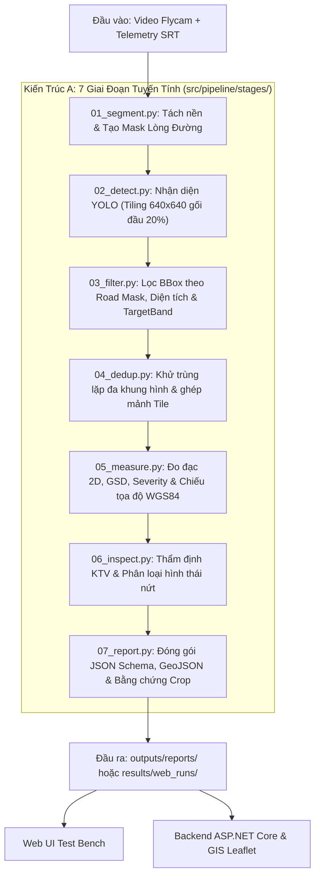

# Đặc Tả Kiến Trúc A: Pipeline Tuyến Tính RoadGuard AI (Linear Pipeline v2.0)
> Tài liệu thiết kế luồng xử lý nhận diện và phân tích khuyết tật mặt đường 7 giai đoạn.

---

## 1. Triết lý Thiết Kế

Kiến Trúc A loại bỏ sự phân mảnh giữa các runner cũ (`pipeline.py` cũ, `process_raw_video.py`, `execute_analysis_sync` tự viết trong UI) để hướng về một **Pipeline tuyến tính chuẩn hóa duy nhất**:
1. **Một file = Một giai đoạn (Stage):** Độc lập, rõ ràng, dễ bảo trì và dễ viết test.
2. **Interface thống nhất:** Mọi stage đều cài đặt hàm `def run(ctx: dict) -> dict`.
3. **Cấu hình tập trung:** Mọi ngưỡng lọc, đường dẫn mô hình, và cờ bật/tắt được kiểm soát bởi [configs/pipeline.yaml](file:///f:/train%20AI%20đồ%20án/configs/pipeline.yaml).
4. **Không hardcode Class ID:** Toàn bộ nhãn và lớp được tải động từ [class_map.json](file:///f:/train%20AI%20đồ%20án/class_map.json).

---

## 2. Sơ đồ 7 Giai đoạn Tuyến tính



---

## 3. Chi tiết từng Stage

### Giai đoạn 1: `01_segment.py` (Road Surface Segmentation)
* **Mục tiêu:** Tạo mặt nạ nhị phân tách lòng đường khỏi các vùng gây nhiễu (vỉa hè, mái nhà, cây cối, bầu trời).
* **Thuật toán:** Adaptive Otsu Thresholding trên vùng ROI quan sát + Phép toán hình thái học (Morphological Closing).
* **Dữ liệu vào/ra:** Nhận `frame['image']`, gán `frame['road_mask']` (ndarray `uint8` $0-255$).

### Giai đoạn 2: `02_detect.py` (Object Detection)
* **Mục tiêu:** Phát hiện khuyết tật ổ gà và vết nứt bằng YOLOv11.
* **Kỹ thuật:** Cắt mảnh 640x640 có gối đầu 20% (Tiling Engine) hoặc inference trực tiếp; map nhãn từ `class_map.json`.
* **Dữ liệu vào/ra:** Sinh `f_info['raw_detections']` và `ctx['raw_detections']`.

### Giai đoạn 3: `03_filter.py` (Mask & Geometric Filtering)
* **Mục tiêu:** Loại bỏ báo động giả ngoài mặt đường và các BBox nhiễu.
* **Tiêu chí lọc:**
  * Confidence $\ge$ `min_confidence` (mặc định $0.25$).
  * Diện tích BBox tối thiểu $\ge 64$ px, tối đa $\le 50\%$ diện tích khung hình.
  * Tỷ lệ giao cắt với Road Mask $\ge 35\%$.
  * Lọc theo `target_band` (mặc định: `SURFACE`).
* **Dữ liệu vào/ra:** Sinh `ctx['filtered_detections']`.

### Giai đoạn 4: `04_dedup.py` (Deduplication)
* **Mục tiêu:** Đảm bảo cùng 1 khuyết tật xuất hiện liên tiếp qua 2-4 giây bay hoặc bị cắt qua 2 mảnh tile chỉ được đếm 1 lần.
* **Thuật toán:** `DefectDeduplicator` (kết hợp chênh lệch thời gian $\Delta t$, khoảng cách chuẩn hóa, tương quan màu HSV).
* **Dữ liệu vào/ra:** Sinh `ctx['deduped_detections']` kèm cluster head đại diện.

### Giai đoạn 5: `05_measure.py` (Measurement & Georeferencing)
* **Mục tiêu:** Ước lượng kích thước thực địa và định vị GPS mặt đất.
* **Tính toán:**
  * GSD (mm/px) theo độ cao bay telemetry.
  * Chiều rộng ước tính (mm) và chiều dài (m).
  * Xếp loại mức độ nghiêm trọng: `LOW`, `MEDIUM`, `HIGH`, `CRITICAL`.
  * Chiếu tâm khuyết tật xuống tọa độ mặt đất chuẩn WGS84 (`calculate_defect_ground_coords`).
* **Dữ liệu vào/ra:** Sinh `ctx['measured_detections']`.

### Giai đoạn 6: `06_inspect.py` (Expert Inspection & Morphology)
* **Mục tiêu:** Cắt ảnh cận cảnh (Crop) và thẩm định chuyên sâu.
* **Chức năng:**
  * Phân loại hình thái vết nứt (nứt dọc, ngang, chân chim, mép đường, khối).
  * Ước lượng cấp độ bề rộng nứt ($<3$mm, $3-6$mm, $>6$mm).
  * Đánh giá nguy cơ kết cấu và đề xuất kỹ thuật xử lý.
* **Dữ liệu vào/ra:** Sinh `ctx['inspected_detections']`.

### Giai đoạn 7: `07_report.py` (Packaging & Evidence)
* **Mục tiêu:** Xuất xưởng toàn bộ hồ sơ nghiệm thu.
* **Sản phẩm:**
  * `crops/`: Ảnh chụp cận cảnh từng khuyết tật.
  * `frames/`: Ảnh khung hình có vẽ Bounding Box trực quan.
  * `inspection_report.json`: Khớp 100% hợp đồng `AIDetectionPayloadFormatter`.
  * `inspection_layer.geojson`: Dành cho hiển thị trên bản đồ số hóa Leaflet / Mapbox.

---

## 4. Cách Sử Dụng API

```python
from src.pipeline.pipeline import run_video_analysis_task

report = run_video_analysis_task(
    video_path="data/raw_videos/DJI_0057.MP4",
    model_path="weights/trained/roadguard_best_15k.pt",
    output_dir="outputs/reports/flight_run1",
    conf_threshold=0.25,
    max_duration_seconds=30,
    sampling_rate_fps=2,
    use_tiling=True
)

print("Tổng khuyết tật:", report["summary"]["total_defects"])
```
