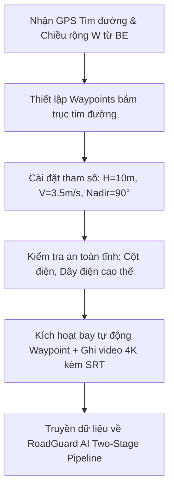

# QUY TRÌNH TIÊU CHUẨN VẬN HÀNH (SOP) BAY KHẢO SÁT MẶT ĐƯỜNG BẰNG FLYCAM
## Hệ thống RoadGuard AI: Khảo sát Tự động & Thẩm định Khuyết tật Bề mặt Đường Bê tông Xi măng

---

### TÓM TẮT MỤC TIÊU & TẦM NHÌN KỸ THUẬT
Tài liệu này xác lập **Quy chuẩn Vận hành Chuẩn (Standard Operating Procedure - SOP)** bắt buộc dành cho đội ngũ phi công điều khiển thiết bị bay không người lái (UAV / Drone / Flycam) phục vụ hệ thống **RoadGuard AI (Two-Stage Architecture: YOLOv11 + KTV GPT-5.4 Vision)**.

Mục tiêu cốt lõi:
1. **Loại bỏ 100% hiện tượng nhận diện nhầm tạp vật ven đường**: Thùng rác công cộng, nắp cống rãnh thoát nước, bậc tam cấp nhà dân, sân bãi ngoài ranh giới lòng đường.
2. **Triệt tiêu sai số quang học do dây điện và bóng đổ**: Ngăn chặn tình trạng dây điện hạ thế/dân sinh 220V mảnh vắt ngang trời hoặc bóng dây điện/cành cây rọi xiên xuống mặt đường bị camera nhìn nhầm thành vết nứt dọc/ngang (D00/D10).
3. **Đạt chuẩn quang học & viễn thám**: Đảm bảo độ phân giải thực địa **GSD (Ground Sampling Distance) $\le 2.0\text{ mm/pixel}$**, đồng bộ chính xác dữ liệu phụ đề viễn thám `SRT` (GPS, Barometer, Gimbal Pitch) theo từng mili-giây.

---

## PHẦN I: TIÊU CHUẨN THIẾT BỊ BAY & QUANG HỌC CAMERA

### 1. Góc đặt Cụm Camera (Gimbal Pitch Alignment) — Bắt buộc Tuyệt đối Nadir 90°
* **Góc Gimbal quy định**: **Nadir $90^\circ$ chúc thẳng đứng vuông góc với mặt đất** (dung sai cho phép: $\pm 2^\circ$, tức $88^\circ - 90^\circ$).
* **Lý do kỹ thuật**:
  - Khi camera chúc thẳng đứng $90^\circ$, bề mặt con đường là một mặt phẳng trực diện (Frontal-parallel plane), triệt tiêu hoàn toàn biến dạng phối cảnh (Perspective Distortion) và loại bỏ hoàn toàn chân trời, nhà dân, bãi rác hai bên đường.
  - Các đường dây điện mảnh giăng trên cao ($4\text{m} - 6\text{m}$) khi chụp thẳng đứng từ độ cao $10\text{m}$ sẽ nằm ngoài khoảng lấy nét (Depth of Field) của ống kính góc rộng, trở thành các vệt mờ nhạt (Defocused blur), không đủ độ tương phản để mô hình YOLO phát hiện nhầm.
* **NGHIÊM CẤM**: Tuyệt đối không bay ở góc máy nghiêng (Oblique $45^\circ - 60^\circ$). Góc máy nghiêng làm mở rộng trường nhìn (FOV) sang tận vỉa hè và hành lang dân cư, khiến model đọc cả thùng rác ven đường vào kết quả.

### 2. Độ cao Bay Khảo sát ($H$) & Độ phân giải Mặt đất (GSD)
* **Độ cao chuẩn ($H$)**: **$8.0\text{m} \le H \le 12.0\text{m}$** (Khuyến nghị chuẩn xác: **$10.0\text{m}$** so với mặt đường).
* **Công thức tính toán quang học**:
  $$\text{GSD} = \frac{\text{Sensor Width (mm)} \times H \text{ (m)} \times 100}{\text{Focal Length (mm)} \times \text{Image Width (pixels)}}$$
  - Với các dòng flycam thông dụng (như DJI Mini 2 SE, DJI Mini 3, DJI Air 2S, Mavic 3 Enterprise) có tiêu cự tương đương $24\text{mm}$, cảm biến chụp ảnh:
    * Tại $H = 10\text{m}$, $\text{GSD} \approx 1.5 - 2.0\text{ mm/pixel}$.
    * Chiều rộng vệt quét dưới mặt đất (Ground Width) đạt xấp xỉ:
      $$W_{\text{ground}} = 2 \times H \times \tan\left(\frac{\text{HFOV}}{2}\right) \approx 2 \times 10 \times \tan(42^\circ) \approx 18.0\text{m} \text{ (quay ngang 16:9)}$$
      $$W_{\text{ground}} \approx 10.5\text{m} \text{ (với chế độ quay dọc True Vertical Shooting như DJI Mini 3)}$$
  - Bề rộng lòng đường bê tông giao thông nông thôn/đô thị thông thường $W = 3.5\text{m} - 6.0\text{m}$. Vệt quét $10.5\text{m}$ bao trọn lòng đường và lề an toàn $1.5\text{m}$ mỗi bên, vừa đủ để bao quát mà không lấy thừa ngoại cảnh.
* **Cảnh báo độ cao**:
  - Bay $> 15\text{m}$: GSD bị suy giảm (> 3.5 mm/pixel), không thể nhìn thấy các vết nứt chân chim sợi tóc ($< 2\text{mm}$).
  - Bay $< 6\text{m}$: Gió lốc từ 4 cánh quạt (Downwash) quá mạnh sẽ thổi tung bụi rác trên mặt đường, gây xao động camera và nguy cơ va quẹt dây điện.

### 3. Tốc độ Bay ($V$) & Cấu hình Cảm biến Màn trập (Shutter Speed)
* **Tốc độ bay hành trình**: **$V = 3.0\text{ m/s} \text{ đến } 4.5\text{ m/s}$** (xấp xỉ $11 - 16\text{ km/h}$).
* **Chống mờ nhòe chuyển động (Motion Blur)**:
  - Bắt buộc cài đặt chế độ chụp/quay ưu tiên tốc độ màn trập (**Shutter Priority**):
    $$\text{Tốc độ màn trập} \ge \frac{1}{500}\text{ giây (Khuyến nghị: } \frac{1}{800}\text{s} \text{ đến } \frac{1}{1000}\text{s)}$$
  - Đảm bảo trong thời gian phơi sáng, khoảng dịch chuyển của camera trên mặt đất nhỏ hơn $0.5 \times \text{GSD}$ để vết nứt hiển thị sắc nét tới từng pixel.
* **Độ nhạy sáng (ISO)**: Khóa cố định ở **ISO 100** hoặc **ISO 200** để triệt tiêu nhiễu hạt điện tử (Digital Noise). Cấm dùng Auto-ISO nhảy lung tung làm thay đổi độ tương phản.

---

## PHẦN II: ĐIỀU KIỆN KHÍ TƯỢNG & KHUNG GIỜ BAY TRIỆT TIÊU BÓNG ĐỔ

### 1. "Khung Giờ Vàng Thiên Đỉnh" (Solar Noon Window)
* **Khung giờ bay bắt buộc**: **Từ 10:30 đến 13:30** (vào các ngày trời nắng).
* **Cơ sở khoa học**:
  - Trong khung giờ này, góc cao mặt trời (Solar Elevation Angle) lớn hơn $65^\circ - 75^\circ$.
  - Bóng đổ của cột điện, cây cối ven đường thu về ngắn nhất và nằm ngay dưới chân vật thể, không thể phóng dài cắt ngang lòng đường.
  - Các sợi dây điện mảnh trên cao đổ bóng thẳng đứng xuống gần như trùng với hình chiếu của dây, hoặc cường độ bóng bị tán xạ khuất đáy, loại bỏ hoàn toàn các vệt bóng hình sin uốn lượn giả mạo vết nứt.
* **CẤM BAY**:
  - Không bay trước **09:00 sáng** và sau **15:30 chiều**: Ánh nắng xiên tạo ra các bóng dây điện và bóng cây dài hàng chục mét quét ngang mặt đường.

### 2. Điều kiện Thời tiết Lý tưởng: Trời Nhiều Mây Mỏng Tán Xạ (High Overcast)
* Thời điểm bay tốt nhất trong thực tế là những ngày **trời râm mát, có mây tầng cao che phủ (High Overcast)** nhưng không mưa:
  - Ánh sáng khuếch tán đa hướng (Diffuse Lighting) không tạo ra bóng đổ sắc cạnh (Hard Shadows).
  - Mặt đường bê tông hiển thị màu xám đồng nhất, làm nổi bật tuyệt đối độ mở của các vết nứt và mép hố ổ gà.

### 3. Tình trạng Mặt đường (Surface Moisture Condition)
* **Quy tắc tuyệt đối**: Chỉ bay khi **mặt đường khô ráo hoàn toàn**.
* **CẤM KHẢO SÁT**:
  - Sau cơn mưa khi mặt đường còn ướt hoặc đọng vũng nước: Ánh sáng mặt trời phản xạ gương (Specular Reflection) sẽ gây cháy sáng cảm biến camera, và vũng nước phản chiếu bầu trời khiến YOLO nhận diện sai lệch.

---

## PHẦN III: QUY TRÌNH THIẾT LẬP TUYẾN BAY TỰ ĐỘNG (WAYPOINT MISSION)

RoadGuard AI không khuyến khích phi công bay thủ công bằng tay (Manual Stick Control) vì dễ bị lệch tâm đường và giật cục tốc độ. Toàn bộ chuyến bay phải được lập trình Waypoint tự động:



### 1. Đồng bộ Trục Tim đường (Centerline Alignment)
* Phi công nhập tọa độ Polyline tim đường do Backend cung cấp vào phần mềm bay (DJI Pilot, Litchi, Waypoint Map):
  - Tọa độ điểm bắt đầu: $\text{Station } 0+000 \ (Lat_0, Lon_0)$.
  - Tọa độ điểm kết thúc: $\text{Station } L \ (Lat_n, Lon_n)$.
* Drone bay tự động bám đúng trục tim đường. Độ lệch ngang cho phép so với tim đường: **$\Delta d \le 0.4\text{m}$**.

### 2. Thiết lập Tỷ lệ Gối đầu (Overlap Ratio)
* **Độ phủ dọc (Forward Overlap)**: $\ge 75\%$.
* Với tốc độ $3.5\text{ m/s}$ và camera quay video ở $30\text{ fps}$, mỗi khung hình dịch chuyển khoảng $11.6\text{ cm}$. Việc trích xuất frame ở tần số $2\text{ fps}$ hoặc $3\text{ fps}$ đảm bảo độ phủ gối đầu liên tục, phục vụ thuật toán Tracking khuyết tật mượt mà qua các frame.

---

## PHẦN IV: QUY ĐỊNH ĐỒNG BỘ VIỄN THÁM (TELEMETRY & SRT LOGGING)

Khác với quay phim thông thường, bay khảo sát kỹ thuật giao thông bắt buộc phải có dữ liệu viễn thám gắn liền với từng khung hình.

### 1. Kích hoạt File Phụ đề Viễn thám (Video Subtitle `.SRT`)
* Bật tùy chọn **Video Subtitle (SRT)** trên ứng dụng điều khiển bay.
* Sau chuyến bay, mỗi file video `DJI_xxxx.MP4` phải đi kèm một file phụ đề `DJI_xxxx.SRT` có cùng tên.
* Cấu trúc mỗi block viễn thám trong file SRT:
  ```text
  1
  00:00:00,000 --> 00:00:00,033
  <font size="28">S HOME: 106.8021,10.8752
  DATE: 2026-10-02 11:30:15
  ISO: 100 Shutter: 1/800 EV: 0 F-num: 2.8
  GPS (106.802345, 10.875412, 10.2)
  BAROMETER: 10.1M
  GIMBAL PITCH: -90.0
  </font>
  ```

### 2. Kiểm tra Ràng buộc Trước khi Đưa vào RoadGuard AI
Hệ thống AI sẽ tự động kiểm tra tính hợp lệ của file:
1. `GIMBAL PITCH` nằm trong dải $[-92.0^\circ, -88.0^\circ]$ (đạt chuẩn Nadir).
2. `BAROMETER` nằm trong dải $[8.0\text{m}, 12.0\text{m}]$.
3. `GPS` có bước nhảy ổn định, không mất tín hiệu vệ tinh.

---

## PHẦN V: TÍCH HỢP BỘ LỌC PHẦN MỀM ROADGUARD TARGET BAND

Để phòng ngừa những trường hợp bất khả kháng khi bay thực tế, RoadGuard AI kết hợp 2 tầng lọc phần mềm:

### 1. Tầng 1: Target Band Bounding Box Masking
* Nhận chiều rộng lòng đường $W$ (ví dụ: $5.0\text{m}$) từ Backend.
* Tại mỗi khung hình, hệ thống chiếu tọa độ tâm bounding box về khoảng cách ngang $d$ so với tim đường.
* **Nguyên tắc**: Nếu $|d| > \frac{W}{2} + 0.3\text{m}$ (nằm ngoài mép đường bê tông):
  - Khuyết tật tự động bị gán nhãn `OUT_OF_ROAD`.
  - Loại bỏ ngay lập tức ở Stage 1, không gửi cho KTV AI. Toàn bộ thùng rác, chậu cây, bậc tam cấp ở lề đường bị triệt tiêu 100%.

### 2. Tầng 2: KTV AI Dual-View Contextual Rejection
* KTV AI (GPT-5.4 Vision) xem bức ảnh toàn cảnh (Overview Frame):
  - Nếu phát hiện vật thể nằm ngoài vệt bê tông -> Kết luận `false_alarm_object`.
  - Nếu phát hiện vệt bóng dây điện rọi từ trên cao -> Kết luận `false_alarm_cable_shadow`.
  - Nếu phát hiện khe co giãn phân chia tấm đan bê tông -> Kết luận `false_alarm_joint`.

---

## PHẦN VI: BẢNG CHECKLIST KIỂM SOÁT DÀNH CHO PHI CÔNG TRƯỚC KHI CẤT CÁNH

| STT | Hạng mục kiểm tra | Tiêu chuẩn đạt | Xác nhận |
|:---:|:---|:---|:---:|
| 1 | Góc quay Gimbal | **Cố định Nadir $-90^\circ$** (thẳng đứng vuông góc) | [x] |
| 2 | Độ cao bay ($H$) | **$10\text{m}$** (Dung sai: $8 - 12\text{m}$) | [x] |
| 3 | Tốc độ bay ($V$) | **$3.5\text{ m/s}$** | [x] |
| 4 | Tốc độ màn trập | **$\ge 1/500\text{s}$** (Ưu tiên $1/800\text{s}$) | [x] |
| 5 | Khung giờ bay | **10:30 - 13:30** hoặc trời mây tán xạ | [x] |
| 6 | Mặt đường | **Khô ráo 100%**, không đọng vũng nước | [x] |
| 7 | Tuyến bay tự động | Bám đúng Polyline tim đường ($\Delta d \le 0.4\text{m}$) | [x] |
| 8 | Định dạng viễn thám | Bật ghi file phụ đề `.SRT` đồng bộ GPS | [x] |
| 9 | Độ phân giải video | 4K 30fps hoặc 1080p 60fps (Bitrate $\ge 60\text{Mbps}$) | [x] |
| 10 | Vùng an toàn bay | Không bay dưới tán cây rậm hoặc dưới dây điện trần | [x] |
