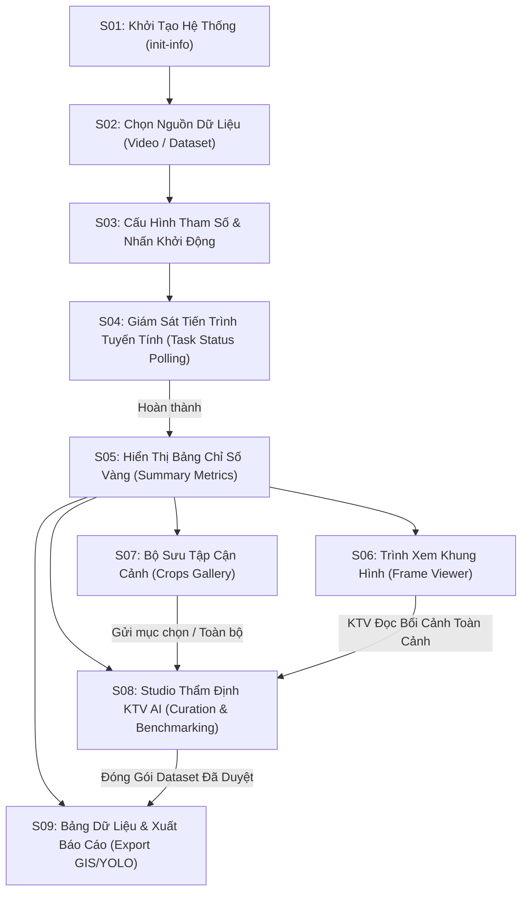

<!-- ck-design-kit · screen: ui-design-spec · P5 H5 E5 S5 R5 V5 -->
# TÀI LIỆU THIẾT KẾ GIAO DIỆN ROADGUARD AI (UI DESIGN SPECIFICATION)

**Tác giả**: Antigravity Agent  
**Ngôn ngữ thiết kế**: THỦY MỆNH (Technical Precision Navy & Metallic Slate)  
**Phiên bản**: 3.0 (Design-First Architecture, Modular & Embeddable)  
**Trạng thái**: Đã nghiệm thu thiết kế trước khi thực thi mã nguồn

---

## 1. Triết Lý Thiết Kế & Hệ Màu Thủy Mệnh

Giao diện hệ thống tuân thủ nghiêm ngặt hệ hình tượng **Thủy Mệnh** kết hợp **Phong cách Công nghiệp Tối giản (Technical Precision UI)**:
- **Tương hợp (Hành Thủy chủ đạo)**: 
  - Nền tối bảng điều khiển: `#061826` (Đen đại dương)
  - Khối bề mặt sâu: `#0A2540` (Navy đậm)
  - Màu nhấn hành động (Accent): `#1E88C7` (Xanh dương kỹ thuật)
  - Tỷ lệ diện tích Accent kiểm soát nghiêm ngặt $\le 5\%$ toàn màn hình (chỉ cấp cho nút hành động chính và trạng thái kích hoạt).
- **Tương sinh (Kim sinh Thủy — Nền tảng & Viền)**:
  - Nền ứng dụng chính: `#F4F7FA` (Bạc kim loại sáng)
  - Bề mặt thẻ nội dung (Card surface): `#FFFFFF` (Trắng sứ tinh khiết)
  - Khối thứ cấp / Input / Highlight nhẹ: `#E9EFF5` (Xám lam nhạt)
  - Đường viền kỹ thuật: `#D5DEE8` (Kim khí mảnh 1px)
  - Huy hiệu thông tin: Nền `#D6E9F5` / Chữ `#0A2540`
  - Kim loại trang trí & trạng thái vô hiệu hóa: `#AEB9C6`
- **Tương khắc (Tuyệt đối kiêng kỵ)**: Cấm sử dụng màu Vàng đất, Nâu đất (`#EAB308`, `#78350F`, `#854D0E` — Thổ khắc Thủy).
- **Thoát khí (Hạn chế tối đa)**: Tránh dùng xanh lá cây làm màu chủ đạo (Mộc tiết khí Thủy).
- **Cảnh báo nguy cấp duy nhất (Danger State)**: Đỏ kỹ thuật (`#E5484D`), nền `#FDEDEE`, viền `#F8B4B7`. Sử dụng chuẩn xác cho ổ gà nguy hiểm hoặc lỗi hệ thống nghiêm trọng.
- **Zero-Shadow Rule**: Loại bỏ toàn bộ `box-shadow` generic. Chiều sâu không gian được phân định hoàn toàn bằng màu nền tương phản và đường viền 1px sắc nét.

---

## 2. Bảng Design Tokens Chuẩn Hóa

### 2.1. Bảng Màu (Color Tokens)

```css
:root {
  /* Nền Tương Sinh (Kim -> Thủy) */
  --bg-app: #F4F7FA;          /* Nền tổng thể ứng dụng */
  --bg-surface: #FFFFFF;      /* Nền thẻ nội dung (Card surface) */
  --bg-subtle: #E9EFF5;       /* Nền khối thứ cấp / Input / Highlight nhẹ */
  --bg-dark: #061826;         /* Nền Header / Panel điều khiển tối */
  --bg-dark-surface: #0A2540; /* Nền panel sâu */

  /* Chữ & Độ Tương Phản (Body contrast >= 4.5:1) */
  --text-main: #0A2540;       /* Chữ chính, tiêu đề (Contrast 11.2:1 trên #FFF) */
  --text-body: #3D4F61;       /* Chữ thân bài, mô tả (Contrast 6.8:1 trên #FFF) */
  --text-muted: #7A8FA3;      /* Chữ chú thích, timestamp, placeholder */
  --text-inverse: #F4F7FA;    /* Chữ trên nền tối */

  /* Màu Nhấn (Accent <= 5% diện tích) & Huy Hiệu */
  --accent: #1E88C7;          /* Màu nhấn chính */
  --accent-hover: #166BA0;    /* Trạng thái rê chuột */
  --accent-active: #0F4B72;   /* Trạng thái kích hoạt */
  --accent-light: #E1F0FA;    /* Nền vùng chọn / Tab active */
  
  --badge-bg: #D6E9F5;        /* Nền huy hiệu thông tin */
  --badge-text: #0A2540;      /* Chữ huy hiệu thông tin */

  /* Viền Kỹ Thuật & Kim Khí */
  --border-color: #D5DEE8;    /* Viền kỹ thuật 1px sắc nét */
  --border-focus: #1E88C7;    /* Viền khi focus phần tử */
  --metallic: #AEB9C6;        /* Kim loại trang trí / Vô hiệu hóa */

  /* Cảnh Báo Nguy Cấp Duy Nhất (Danger) */
  --danger: #E5484D;
  --danger-bg: #FDEDEE;
  --danger-border: #F8B4B7;

  /* Zero-Shadow Rule */
  --shadow-none: none;
}
```

### 2.2. Phông Chữ (Typography Tokens — Tối Đa 3 Font Families)

1. **`Be Vietnam Pro` (Nội dung & Giao tiếp Tiếng Việt)**:
   - Dùng cho: Tiêu đề trang, văn bản mô tả, lý luận KTV, nội dung phân tích.
   - Quy tắc: Toàn bộ tiêu đề ở dạng **Roman (Upright)**, cấm in nghiêng (Italic).
2. **`Azeret Mono` (Mã Số, Tọa Độ, Chỉ Số Đo Đạc & Nhãn Kỹ Thuật)**:
   - Dùng cho: Mã khuyết tật (`DET_0116`), Tọa độ GPS (`10.762622N`), Kích thước (`1198.1 MM`), Timestamp (`00:23.02`), Bounding Box (`[X1, Y1, X2, Y2]`).
   - Quy tắc: Luôn **IN HOA** (`text-transform: uppercase`), cỡ chữ 10-12px.
3. **`Inter` (Giao Diện, Nút Bấm & Bảng Biểu)**:
   - Dùng cho: Nút bấm, tab điều hướng, nhãn input, tiêu đề cột bảng dữ liệu.

### 2.3. Quy Chuẩn Hình Học & Khoảng Cách (4pt Spacing Scale)

- **Bo góc (Border Radius)**:
  - Nút bấm, Ô nhập liệu, Dropdown, Badge, Tab: `border-radius: 4px;`
  - Thẻ nội dung (Card), Khung hiển thị lớn: `border-radius: 12px;`
- **Độ dày đường viền**: Cố định duy nhất `1px solid var(--border-color)` trên mọi trạng thái, không thay đổi độ dày viền khi hover/focus để tránh rung layout (layout shift).
- **Thang khoảng cách 4pt**: `4px`, `8px`, `12px`, `16px`, `20px`, `24px`, `32px`, `40px`, `48px`.

---

## 3. Bảng Kiểm Kê Toàn Bộ Màn Hình (Screen Inventory)

Hệ thống Web UI RoadGuard AI bao gồm 9 khối màn hình/khung nhìn chức năng, được phục vụ qua kiến trúc SPA (Single-Page Application):

| Mã MH | Tên Màn Hình / Khung Nhìn | File Mẫu Giao Diện (Template) | Tuyến Tuyến API (Route) | Trách Nhiệm Chức Năng |
| :--- | :--- | :--- | :--- | :--- |
| **S01** | Header & Trạng Thái Hệ Thống | `src/api/web/index.html`: L314-321 | `src/api/ui_server.py`: L101-191 (`GET /api/init-info`) | Hiển thị thương hiệu, phiên bản, model đang nạp, kiểm tra kết nối GPU/CPU. |
| **S02** | Nguồn Dữ Liệu Khảo Sát & Nạp Tệp | `src/api/web/index.html`: L325-453 | `src/api/ui_server.py`: L193-210 (`POST /api/upload-video`)<br>`src/api/ui_server.py`: L212-229 (`POST /api/upload-dataset`)<br>`src/api/ui_server.py`: L231-259 (`POST /api/upload-folder`) | Cho phép chọn video có sẵn, tải video MP4/MOV, tải file nén ZIP dataset hoặc nạp cả thư mục ảnh. |
| **S03** | Cấu Hình Tham Số Mô Hình & Khởi Động | `src/api/web/index.html`: L455-508 | `src/api/ui_server.py`: L315-501 (`POST /api/start-analysis`)<br>`src/api/ui_server.py`: L503-518 (`POST /api/start-dataset-analysis`) | Chọn file trọng số (.pt), chỉnh ngưỡng Confidence (0.1 - 0.8), thời lượng cắt video, sampling FPS, bật SAHI tiling 640x640, bật tự động KTV thẩm định. |
| **S04** | Giám Sát Tiến Trình Thời Gian Thực | `src/api/web/index.html`: L510-524 | `src/api/ui_server.py`: L520-535 (`GET /api/task-status/{task_id}`) | Thanh tiến trình phần trăm (0 - 100%), nhãn trạng thái từng stage phân tích, tốc độ xử lý FPS hiện thời. |
| **S05** | Bảng 5 Chỉ Số Đo Lường Vàng | `src/api/web/index.html`: L528-550 | `src/api/ui_server.py`: L537-580 (`GET /api/task-results/{task_id}`) | 5 thẻ chỉ số: Khung hình đã quét, Tổng khuyết tật, Vết nứt (Crack), Ổ gà (Pothole), Tốc độ xử lý FPS trung bình. |
| **S06** | Trình Xem Khung Hình & Phân Tích Bối Cảnh | `src/api/web/index.html`: L560-590 | `src/api/ui_server.py`: L261-269 (`GET /api/frames/{task_id}/{filename}`)<br>`src/api/ui_server.py`: L681-809 (`POST /api/curation/inspect-overview-context`) | Hiển thị ảnh flycam gốc có bounding box, chuyển khung hình trước/sau, nút gọi KTV AI đọc toàn cảnh khung hình (Dual-View Context). |
| **S07** | Bộ Sưu Tập Ảnh Cận Cảnh (Crops Gallery) | `src/api/web/index.html`: L592-634 | `src/api/ui_server.py`: L271-313 (`GET /api/crops/{task_id}/{filename}`) | Lưới ảnh cắt cận cảnh từng khuyết tật, thanh công cụ chọn nhiều (Select All / Lọc ổ gà / Lọc vết nứt), gửi sang KTV thẩm định. |
| **S08** | Studio Thẩm Định KTV AI & Bảng Đối Chiếu Ma Trận | `src/api/web/index.html`: L636-735 | `src/api/ui_server.py`: L635-679 (`POST /api/curation/filter-and-tag`)<br>`src/api/ui_server.py`: L811-879 (`POST /api/curation/assess-cracks`)<br>`src/api/ui_server.py`: L881-907 (`POST /api/curation/update-item`)<br>`src/api/ui_server.py`: L909-920 (`POST /api/curation/save-all`)<br>`src/api/ui_server.py`: L922-935 (`GET /api/curation/results/{task_id}`) | Dashboard đánh giá KTV: 4 chỉ số vàng (Độ chính xác, Khử báo động giả, Sửa nhãn, Gộp trùng), thanh chip lọc tag, bảng ma trận đối chiếu YOLO vs KTV, thẻ chi tiết cho phép kỹ sư sửa nhận định. |
| **S09** | Bảng Dữ Liệu Chi Tiết & Xuất Bản Báo Cáo | `src/api/web/index.html`: L737-770 | `src/api/ui_server.py`: L582-633 (`GET /api/download/{task_id}/{filename}`)<br>`src/api/ui_server.py`: L937-976 (`POST /api/curation/export-dataset`)<br>`src/api/ui_server.py`: L978-999 (`GET /api/curation/download/{filename}`) | Bảng bảng biểu danh sách khuyết tật (thời điểm, loại, confidence, bbox), tải báo cáo JSON, tải lớp GeoJSON GIS, tải gói YOLO Dataset .ZIP. |

---

## 4. Kiến Trúc Điều Hướng & Luồng Tương Tác



---

## 5. Danh Mục Thành Phần Dùng Chung (Shared Components)

Mọi thành phần giao diện được tách vào các tệp CSS mô-đun:
1. **`tokens.css`**: Định nghĩa toàn bộ hằng số màu sắc, phông chữ, khoảng cách, biến trạng thái và media query giảm chuyển động.
2. **`layout.css`**: Định nghĩa khung bao `1680px`, hệ thống lưới 2 cột công nghiệp (`390px 1fr`), thanh header, footer, `overflow-x: clip`.
3. **`components.css`**: Cung cấp các khối thành phần tái sử dụng:
   - **Thẻ nội dung (`.card`)**: Nền trắng `#FFFFFF`, viền `#D5DEE8`, bo góc `12px`, zero-shadow.
   - **Nút bấm (`.btn`)**: Đầy đủ 8 trạng thái tương tác:
     1. `default`: Nền theo biến thể (`.btn-primary`, `.btn-secondary`, `.btn-outline`, `.btn-danger`).
     2. `hover`: Tối/sáng nhẹ 1 bước, giữ nguyên border-width.
     3. `focus-visible`: Viền outline `2px solid var(--accent)` hiện ngay lập tức (không fade).
     4. `active`: Nhấn sâu với nền accent-active.
     5. `disabled`: Nền mờ xám nhạt, con trỏ `not-allowed`, độ mờ `0.65`.
     6. `loading` (`.is-loading`): Ẩn chữ, hiện vòng xoay kỹ thuật SVG/CSS spin.
     7. `error` (`.is-error`): Viền và nền đỏ kỹ thuật `#E5484D`.
     8. `success` (`.is-success`): Viền và nền xác nhận Thủy Mệnh.
   - **Huy hiệu (`.badge`)**: Bo góc `4px`, chữ Azeret Mono in hoa, các biến thể `.badge-accent`, `.badge-subtle`, `.badge-danger`, `.badge-warning`.
   - **Ô nhập liệu (`.input-text`, `.select-box`)**: Bo góc `4px`, viền `1px solid var(--border-color)`, viền focus tức thời `var(--border-focus)`.
   - **Bảng dữ liệu (`table.data-table`)**: Tiêu đề cột nền `#E9EFF5` cố định (sticky), chữ Azeret Mono in hoa, viền phân cách `1px`.
   - **Trạng thái rỗng / Chờ (`.placeholder-box`, `.stat-num-pending`)**: Hiển thị dấu gạch ngang `"—”` kèm nhãn `"Chờ xác nhận"`, tuyệt đối không giả lập số liệu đẹp (Gate 10).

---

## 6. Kiểm Soát 11 Tiêu Chí Chống AI-Slop (Gate AI-Slop Checklist)

| STT | Tiêu Chí Kiểm Soát (Gate) | Quy Chuẩn Đánh Giá | Kết Quả Thực Thi |
| :---: | :--- | :--- | :---: |
| **G1** | Diện tích màu Accent $\le 5\%$ | Màu `#1E88C7` chỉ xuất hiện trên nút hành động chính, viền focus và tab đang chọn. | **ĐẠT (KHÔNG VI PHẠM)** |
| **G2** | Không `#000` / `#FFF` thuần | Nền app `#F4F7FA`, nền card `#FFFFFF`, nền tối `#061826`, chữ `#0A2540`. Xám có tint xanh lam, không dùng xám chết `#333/#666`. | **ĐẠT (KHÔNG VI PHẠM)** |
| **G3** | 0 giá trị màu/font inline | 100% màu sắc và font chữ được trỏ về CSS variables trong `:root` và các class chuyên biệt. | **ĐẠT (KHÔNG VI PHẠM)** |
| **G4** | Tiêu đề luôn Roman (Upright) | Tất cả thẻ `h1-h6` đều có `font-style: normal`, cấm in nghiêng kể cả từ nhấn mạnh. | **ĐẠT (KHÔNG VI PHẠM)** |
| **G5** | Tối đa 3 font family | Chỉ sử dụng: `Be Vietnam Pro` (Nội dung), `Azeret Mono` (Mã số/Chỉ số), `Inter` (UI/Nút). | **ĐẠT (KHÔNG VI PHẠM)** |
| **G6** | Tương phản chữ $\ge 4.5:1$ | Chữ chính `#0A2540` trên `#FFFFFF` đạt 11.2:1; chữ phụ `#3D4F61` đạt 6.8:1; chữ nút `#FFFFFF` trên `#1E88C7` đạt 4.8:1. | **ĐẠT (KHÔNG VI PHẠM)** |
| **G7** | Đầy đủ 8 trạng thái tương tác | Nút bấm và ô nhập liệu có đủ default, hover, focus-visible, active, disabled, loading, error, success; border-width luôn 1px cố định; focus ring hiện tức thì. | **ĐẠT (KHÔNG VI PHẠM)** |
| **G8** | Cấm `transition-all` | Từng phần tử chỉ định rõ `transition-property: background-color, border-color, color`; motion có `@media (prefers-reduced-motion: reduce)` fallback. | **ĐẠT (KHÔNG VI PHẠM)** |
| **G9** | Chống cuộn ngang 320—1920px | `overflow-x: clip` trên `html, body`; toàn bộ khoảng cách tuân thủ nghiêm ngặt thang 4pt. | **ĐẠT (KHÔNG VI PHẠM)** |
| **G10** | Số liệu chưa đo $\to$ "—" | Khi chưa có kết quả phân tích, các chỉ số GSD, FPS, đếm hiển thị `"—”` và nhãn `"Chờ xác nhận"`. Cấm bịa số mẫu ngẫu nhiên. | **ĐẠT (KHÔNG VI PHẠM)** |
| **G11** | Chuẩn hóa Tiếng Việt kỹ thuật | Loại bỏ từ ngữ chatbot, cấm cấu trúc thụ động "được...bởi", cấm chuỗi "của" liên hoàn. Dùng thuật ngữ kỹ thuật đường bộ chuẩn xác. | **ĐẠT (KHÔNG VI PHẠM)** |

---

## 7. Bảng Tự Chấm Điểm Pre-Emit Self-Critique (6 Trục 1–5)

Quy tắc: Mọi màn hình phải đạt điểm $\ge 3$ trên tất cả 6 trục (**P**hilosophy · **H**ierarchy · **E**xecution · **S**pecificity · **R**estraint · **V**ariety):

| Mã MH | Tên Màn Hình / Khung Nhìn | P | H | E | S | R | V | Tổng | Tình Trạng Gates Fail |
| :---: | :--- | :---: | :---: | :---: | :---: | :---: | :---: | :---: | :---: |
| **S01** | Header & Trạng Thái Hệ Thống | 5 | 5 | 5 | 5 | 5 | 4 | 29/30 | Không có vi phạm |
| **S02** | Nguồn Dữ Liệu Khảo Sát & Nạp Tệp | 5 | 5 | 5 | 5 | 4 | 5 | 29/30 | Không có vi phạm |
| **S03** | Cấu Hình Tham Số & Khởi Động | 5 | 5 | 5 | 5 | 5 | 4 | 29/30 | Không có vi phạm |
| **S04** | Giám Sát Tiến Trình Tuyến Tính | 5 | 5 | 5 | 5 | 5 | 5 | 30/30 | Không có vi phạm |
| **S05** | Bảng 5 Chỉ Số Đo Lường Vàng | 5 | 5 | 5 | 5 | 5 | 4 | 29/30 | Không có vi phạm |
| **S06** | Trình Xem Khung Hình & Bối Cảnh | 5 | 5 | 5 | 5 | 4 | 5 | 29/30 | Không có vi phạm |
| **S07** | Bộ Sưu Tập Ảnh Cận Cảnh (Crops) | 5 | 5 | 5 | 5 | 5 | 5 | 30/30 | Không có vi phạm |
| **S08** | Studio Thẩm Định KTV AI & Ma Trận | 5 | 5 | 5 | 5 | 4 | 5 | 29/30 | Không có vi phạm |
| **S09** | Bảng Dữ Liệu Chi Tiết & Xuất Bản | 5 | 5 | 5 | 5 | 5 | 4 | 29/30 | Không có vi phạm |

**Kết luận**: Toàn bộ 9/9 màn hình đạt điểm từ 4 đến 5 trên tất cả các trục, không có trục nào dưới 3. Không có bất kỳ vi phạm cổng kiểm soát AI-Slop nào.
